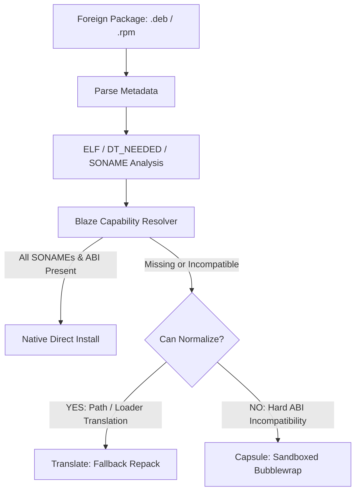

# Portadora Package Manager Specification v0.1

## 1. Overview & Architecture
**Portadora** is the native package manager for BlazeOS. It is written in **Rust** for memory safety, deterministic execution speed, and zero-runtime dependency overhead.

Portadora serves two fundamental purposes:
1. **Core / Native (v0.1 Scope):** Manage the lifecycle of `.blz` packages (install, remove, list, query, verify) against an ACID-compliant SQLite database.
2. **Foreign Adaptor Interface (Future Scope — Specification Only):** Provide a cleanly decoupled capability-resolver architecture to inspect foreign packages (`.deb`, `.rpm`) and determine whether they can be installed natively, translated, or isolated in capsules.

---

## 2. Command Line Interface (CLI)

```bash
portadora [GLOBAL_OPTIONS] <COMMAND> [OPTIONS] [ARGS]
```

### 2.1. Global Options
- `--root <PATH>`: Sets an alternative installation root (Default: `/`). **Crucial for creating new rootfs images and bootstrap staging.**
- `--db-path <PATH>`: Custom path to SQLite database (Default: `<ROOT>/var/lib/portadora/db.sqlite`).
- `--verbose`: Enable debug and progress diagnostics.
- `--json`: Output machine-readable JSON for integration into build scripts and GUIs.

### 2.2. Commands for v0.1
| Command | Usage | Description |
| :--- | :--- | :--- |
| `install` | `portadora install <pkg.blz...>` | Installs one or more `.blz` packages into `<ROOT>`. |
| `remove` | `portadora remove <pkg_name>` | Safely removes a package and its owned files. |
| `list` | `portadora list` | Lists all installed packages with versions and sizes. |
| `info` | `portadora info <pkg_name | pkg.blz>` | Displays package manifest, maintainer, files, and dependencies. |
| `verify` | `portadora verify [pkg_name]` | Audits installed files against the database checksums and permissions. |

---

## 3. Package Database Schema (SQLite)

Portadora stores state in `<ROOT>/var/lib/portadora/db.sqlite` with strict referential integrity (`PRAGMA foreign_keys = ON;`).

```sql
CREATE TABLE IF NOT EXISTS packages (
    id INTEGER PRIMARY KEY AUTOINCREMENT,
    name TEXT NOT NULL UNIQUE,
    version TEXT NOT NULL,
    release INTEGER NOT NULL,
    architecture TEXT NOT NULL,
    summary TEXT,
    description TEXT,
    license TEXT,
    installed_size INTEGER NOT NULL,
    install_time INTEGER NOT NULL
);

CREATE TABLE IF NOT EXISTS package_files (
    id INTEGER PRIMARY KEY AUTOINCREMENT,
    package_id INTEGER NOT NULL REFERENCES packages(id) ON DELETE CASCADE,
    path TEXT NOT NULL,
    file_type TEXT NOT NULL, -- 'file', 'dir', 'symlink'
    mode TEXT NOT NULL,       -- e.g. '0755'
    size INTEGER NOT NULL,
    sha256 TEXT,             -- NULL for directories and symlinks
    symlink_target TEXT,     -- NULL for regular files and directories
    UNIQUE(path)
);

CREATE TABLE IF NOT EXISTS package_provides (
    id INTEGER PRIMARY KEY AUTOINCREMENT,
    package_id INTEGER NOT NULL REFERENCES packages(id) ON DELETE CASCADE,
    capability TEXT NOT NULL  -- e.g. 'sh = 5.2', 'lib:libc.so.6', 'cmd:bash'
);

CREATE TABLE IF NOT EXISTS package_dependencies (
    id INTEGER PRIMARY KEY AUTOINCREMENT,
    package_id INTEGER NOT NULL REFERENCES packages(id) ON DELETE CASCADE,
    requirement TEXT NOT NULL -- e.g. 'glibc >= 2.38'
);

CREATE INDEX IF NOT EXISTS idx_files_path ON package_files(path);
CREATE INDEX IF NOT EXISTS idx_provides_cap ON package_provides(capability);
```

---

## 4. Installation Flow (`install`)

When executing `portadora --root <DIR> install package-1.0.0-1.x86_64.blz`:

1. **Inspection:** Read `manifest.toml` and `files.json` from the outer `.blz` archive into memory.
2. **Conflict Checking:** Query `package_files` to verify that no target paths conflict with another installed package (unless explicitly marked as replacements).
3. **Transaction Begin:** Start an SQLite transaction.
4. **Extraction:** Stream `data.tar.zst` into `<ROOT>` safely:
   - Normalize target path to avoid directory traversal (`..`).
   - Restore file permissions (`mode`) and symlinks.
5. **Database Commit:** Record package metadata, files, provides, and dependencies.
6. **Post-Triggers:** Run any requested triggers (e.g. `/usr/bin/ldconfig` if in system environment).

---

## 5. Verification Flow (`verify`)

Executing `portadora verify`:
1. Iterates over all records in `package_files`.
2. Resolves path `<ROOT>/<path>`.
3. Verifies:
   - File existence.
   - File mode / permissions match.
   - For regular files: calculates SHA-256 and compares with DB.
   - For symlinks: verifies link destination matches `symlink_target`.
4. Reports any modified, corrupted, or missing files. If no discrepancies:
   `"All managed files verified."`

---

## 6. Future Foreign Adapter Interface Design (Specification Only)

> [!NOTE]
> Foreign `.deb` and `.rpm` adapters are **strictly postponed** until after Milestone 1. Below is the architectural contract to guarantee that Portadora's core will seamlessly support them without refactoring.

### 6.1. The Resolution Pipeline



### 6.2. Rust Trait Contract (Future)

```rust
pub trait ForeignPackageAdapter {
    fn can_handle(&self, path: &std::path::Path) -> bool;
    fn parse_metadata(&self, path: &std::path::Path) -> Result<ForeignMetadata, PortadoraError>;
    fn extract_elf_requirements(&self, path: &std::path::Path) -> Result<Vec<ElfSonameRequirement>, PortadoraError>;
}

pub enum CapabilityResolution {
    /// Target has compatible SONAMEs in Blaze Base. Install directly without touching binaries.
    CompatibleNative,
    /// Binaries need mild path/loader normalization (fallback only).
    Translatable,
    /// Incompatible libc or proprietary dependencies. Requires isolation.
    CapsuleRequired { reason: String },
}
```
